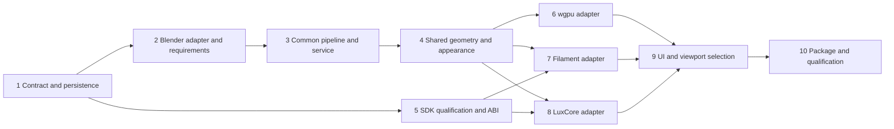

# Selectable Desktop Renderers Implementation Plan

> **For agentic workers:** REQUIRED SUB-SKILL: Use superpowers:subagent-driven-development (recommended) or superpowers:executing-plans to implement this plan task-by-task. Steps use checkbox (`- [ ]`) syntax for tracking.

**Goal:** Select native wgpu, embedded Filament, embedded LuxCore, Blender Eevee, or Blender Cycles/OptiX for native desktop previews and exports while preserving geometry, recovery, and output behavior.

**Architecture:** One immutable scene/frame contract and export pipeline serve engine adapters. The Rust actor owns export contexts; Filament and LuxCore are lazy-loaded in-process bridge DLLs. Native wgpu remains the default inspection renderer, with Filament as an alternative ordinary viewport.

**Tech Stack:** Existing Rust 2024 / eframe 0.36.2 / wgpu 30.0.1, serde, image, native Windows MSVC C++ bridges, version-pinned Filament/LuxCore SDKs after qualification, existing Blender Python worker and FFmpeg encoding.

**Spec:** [Selectable desktop renderers design](../specs/2026-10-15-selectable-renderers-design.md). Read it before implementing a task.

**Status:** Proposed implementation work. Only this plan and its architecture document are delivered by the planning task. Existing README/browser edits are unrelated and must be preserved. Desktop only, confirmed by the user.

## Global Constraints

- Initial Windows target is `x86_64-pc-windows-msvc`.
- Native wgpu stays portable; optional SDK support on other targets is explicitly unqualified until separately built and tested.
- The separate browser application is outside this work.
- Stable output IDs: `wgpu`, `filament`, `luxcore`, `blender_eevee`, `blender_cycles`.
- All geometry remains in build-space millimeters, Z up, until a documented adapter conversion.
- Keep existing limits: at most 2,000,000 source vertices, 4,000,000 triangles, 1 MiB scene metadata, 8 MiB serialized timeline states, 10,000 animation frames, and 8,000 requested output pixels per side.
- Existing stricter format/panel limits still apply. Derived geometry and GPU expansion use checked allocation budgets.
- CPU images are tightly packed RGBA8, top row first, display-encoded sRGB with straight alpha.
- No renderer subprocess for wgpu, Filament, or LuxCore. Existing encoder subprocesses remain output-specific requirements.
- No silent renderer/device/CPU/quality/resolution fallback. Recognized unavailable saved selections remain intact.
- Preserve legacy request/recipe semantics, source protection, owned-job locks, cancellation, atomic publication, and optimized Blender animation batching.
- Preserve current defaults during rollout: Eevee animation, Cycles still/sheet, Native wgpu viewport.
- Run one export at a time. Use per-job cancellation tokens and revision/engine-tagged completions.
- SDK versions and artifacts must be pinned by immutable release/commit and SHA-256 before integration; runtime downloads are prohibited.
- Isolate implementation work before edits, inspect current instructions/status, and stage/commit only each task's owned files.

## Review Focus

- An old project must preserve saved render intent and retained jobs must preserve their existing pixels/provenance; Task 1 and Task 3 test migration and incompatible-reuse rejection. Fresh renders use the current qualified recipe.
- Missing tools or an SDK dependency must disable only affected operations; Task 2 and Task 5 test requirement splitting and lazy load failures.
- Rapid model/engine changes must not show stale images or reset another job's cancellation; Task 3 and Task 9 test delayed completions and queue replacement.
- Resin alpha, physical units, and layer shading must survive transfer and posing; Task 4, Task 6, Task 7, and Task 8 test geometry/color/alpha and visible layer detail.
- Repeated switching, oversized output, or cancellation during readback must not leak contexts or overrun budgets; Task 5 and Task 10 test lifecycle and resource limits.

## File ownership and dependency graph

Paths listed as Create below are proposed new files. Keep adapters focused; do not add all engines to the existing large `jobs.rs`/`app.rs` modules.

| Unit | New files / principal existing integration |
| --- | --- |
| Contract and selection | `src/render/{contract,selection,capabilities}.rs`; `src/project.rs`, `src/settings.rs` |
| Common planning/realization | `src/render/{scene,sequence,geometry,materials,color}.rs`; `src/presentation.rs`, `src/print/slice.rs` |
| Common pipeline/frames | `src/export/{pipeline,frame_sink,recipe}.rs`; existing `jobs.rs`, `identity.rs`, `encode.rs` |
| Registry/service | `src/render/{registry,requirements}.rs`; `src/session.rs` |
| Blender adapter | `src/render/backends/{mod,blender}.rs`; existing `worker.rs`, `renderer/{worker,scene}.py` |
| Native wgpu | `src/render/backends/wgpu.rs`, `src/render/wgpu_studio.rs`, `src/render/shaders/{studio,tonemap}.wgsl`; existing viewport integration |
| Native bridge host | `src/render/embedded/{mod,abi,loader}.rs`, `native/include/turninator_renderer.h`, `native/CMakeLists.txt` |
| Filament | `src/render/backends/filament.rs`, `native/filament/{CMakeLists.txt,bridge.cpp}`, `assets/render/filament/` |
| LuxCore | `src/render/backends/luxcore.rs`, `native/luxcore/{CMakeLists.txt,bridge.cpp}` |
| UI | `src/app/{renderers,renderer_view}.rs`; existing controls/sidebar/workspace/help and `app.rs` |
| Qualification/package | `tools/{qualify-renderers,build-renderers}.ps1`, `native/sdk-lock.json`, package/notices scripts and runtime docs |



Tasks 6–8 may be delegated after Tasks 1–5 have established their interfaces. Task 5 may be qualified independently while core work proceeds, but SDK integration waits for its report. A task is complete only after its checks and focused review pass; make a focused commit at that point.

## Contract vocabulary shared by implementers

Define the types and the structural converter in Task 1, so the Blender adapter and pipeline compile before Task 4 adds geometry realization. Task 4 refines behavior without inventing adapter-local equivalents. Non-ABI types are ordinary Rust-owned data.

| Type | Required meaning / fields |
| --- | --- |
| `BackendId` | Five variants with the stable serialized IDs above. |
| `RenderUsage` | `Interactive`, `Preview`, `Animation`, `Still`, `Sheet`. |
| `BackendQuality` | Tagged variants: `Wgpu { aa: AaQuality, shadows: ShadowQuality }`, `Filament { aa: AaQuality, shadows: ShadowQuality }`, `LuxCore { samples: u32, denoise: bool }`, `Eevee { samples: u32 }`, `Cycles { samples: u32, denoise: bool }`. |
| `AaQuality`, `ShadowQuality` | `Low`, `Medium`, `High`; exact backend settings are versioned in their recipe, never inferred from another engine's samples. |
| `RenderSelection` | `backend: BackendId`, `device: Option<String>`, `quality: BackendQuality`; `None` resolves once to a concrete device during preparation, then records it. |
| `RendererPreferences` | `viewport: ViewportRenderer` (`Wgpu`/`Filament`), animation/still active `RenderSelection`, plus quality profiles indexed by backend and animation/still use. |
| `FeatureSupport` | `Supported`, `Approximate { reason: String }`, `Unsupported { reason: String }`. |
| `BackendStatus` | Backend ID, availability reason/status, qualified capability descriptor; startup status may be `NotProbed`, not an eager GPU init. |
| `BackendIdentity` | Backend ID, adapter recipe version, runtime/bridge/shader/material/color/denoiser digests, concrete device/API/driver strings; only applicable dependencies included. |
| `RenderSceneSnapshot` | `mesh: Arc<Mesh>`, `legacy_scene: Value`, `appearance: RenderAppearance`, `metadata: GeometryMetadata`, `camera: RenderCamera`, `reference_bounds_mm: Bounds`, `warnings: Vec<String>`; Task 1 structural converter, Task 4 behavioral qualification. |
| `FrameKey` | `index: u32` (output time index), `panel: RenderPanel`; derives equality/order/hash and is the unique frame-sink key. |
| `RenderPanel` | `Single`, `Full`, `Section`, `Top`, `Iso`, `Front`, `Right`. |
| `FrameSpec` | `key: FrameKey`, `camera: RenderCamera`, `angle_degrees: f64`, `visible_layers: Option<u32>`, `section: Option<SectionSpec>`, `width: u32`, `height: u32`, `time_seconds: f64`. `None` layers means complete geometry; zero means empty. |
| `FramePlan` | `frames: Vec<FrameSpec>`, `repeat_of: BTreeMap<FrameKey, FrameKey>`; repeated keys refer to an earlier fully equivalent frame in the same panel. |
| `RealizedScene` | `mesh: Arc<Mesh>`, `normals: Vec<[f32; 3]>`, `build_positions_mm: Vec<[f32; 3]>`, `triangle_materials: Vec<u32>`, `design_edges_mm: Vec<[[f32; 3]; 2]>`, `reference_bounds_mm: Bounds`, `analysis: Option<SectionAnalysis>`; aligned vertex arrays can split vertices to preserve flat/smooth edges. Empty stage arrays are valid. |
| `RgbaFrame` | `width: u32`, `height: u32`, `bytes: Vec<u8>` in the specified CPU format. |
| `FrameArtifact` | `Image { key: FrameKey, image: RgbaFrame }` or `Png { key: FrameKey, path: PathBuf }`; dimensions/alpha expectations come from the host's FramePlan, never from adapter claims. |
| `RenderContext<'a>` | `cancel: &'a AtomicBool`, `limits: &'a RenderLimits`, `scratch_dir: &'a Path`, `selection: &'a RenderSelection`, `identity: &'a BackendIdentity`, `pixel_recipe_key: &'a str`, `job_id: u64`, `revision: u64`, `progress: &'a dyn Fn(RenderProgress)`; progress callback is invoked on the actor, never across the C ABI. |
| `RenderProgress` | `key: Option<FrameKey>`, `completed_work: u64`, `total_work: Option<u64>`, `stage: String`, `preview: Option<RgbaFrame>`; preview rate is bounded and carries the context's job/revision/engine tags. |
| `RenderReport` | Actual frame count, warnings, effective identity/quality, geometry-analysis records and phase timings. |
| `RenderLimits` | Checked host/GPU/scratch budgets and output limits; initially preserve current format limits, add measured SDK resource bounds. |

Decide the remaining shared representations here, before delegation:

- `RenderCamera` stores `position_mm: [f64; 3]`, `target_mm: [f64; 3]`, `up: [f64; 3]`, and `projection: RenderProjection`. Projection is `Perspective { vertical_fov_degrees: f64 }` or `Orthographic { vertical_span_mm: f64 }`. Directions are right-handed, Z up. Parse existing `camera_spec()` JSON once; timeline samples convert from `OrbitCamera` through the same converter. Aspect ratio comes from each frame's width/height. Keep current camera near/far conventions in one host camera helper and qualify clipping; workers do not independently fit cameras.
- `GeometryMetadata` contains typed geometry kind (`Original`, `Beads`, `Stepped`), optional existing bead layout/ring size, bead side ranges, face groups (`start_triangle`, exclusive `end_triangle`, tool ID, label, linear RGB), layer ranges (same triangle interval plus layer index and `z_top_mm`), and `solid_layer_tops_mm`. Indices/counts are `u32`, heights are `f64`, colors `[f32; 3]`. Parse/validate every currently emitted `model_scene()` key; preserve source-path and warnings in `legacy_scene` for protection/provenance.
- `RenderAppearance` contains `color: [f32; 3]`, `roughness: f32`, material/studio preset IDs, `resin_clarity: f32`, `resin_cloudiness: f32`, `layer_appearance: bool`, first/later layer heights and groove depth as `f64` millimeters, and display XYZ rotation as `[f64; 3]`. These fields are present in legacy scene JSON. Do not attempt to reconstruct all `SceneSettings.import` fields from that JSON: accepted mesh coordinates already include import units/build rotation, and restoring defaults for missing import fields could apply them twice.
- `SectionAnalysis` stores the versioned existing section-analysis JSON in `legacy: Value`, plus `cap_supported: bool`. The host validates required legacy fields against the existing Python analysis contract; do not invent a second set of volume units or field names. Task 4 may introduce typed views without changing serialized semantics.
- `MaterialSet` contains named physical material records and a triangle-material table: linear base/absorption color, roughness, metallic fraction, anisotropy, coat fraction/roughness, transmission fraction, IOR, absorption density per mm, scattering coefficient per mm and anisotropy. Retain current preset formulas: silk metallic 0.18/anisotropy 0.65; glossy coat 0.35/coat roughness 0.12; resin IOR 1.46, transmission = clarity, roughness = max(0.025, 0.5*cloudiness), absorption density = `(20*(1-clarity)+2)/1000` per mm with the existing absorption-color convention. Legacy presets have scattering zero: cloudiness currently changes roughness, not volume scattering. Nonzero scattering is tested through an explicit synthetic physical-material fixture; do not silently change existing Blender presets to add it.
- `NativePixels` contains width/height, row stride, byte buffer, row origin (`Top`/`Bottom`), channels (`Rgba`/`Bgra`), alpha (`Straight`/`Premultiplied`), and transfer (`Linear`/`Srgb`). Conversion to `RgbaFrame` validates checked lengths, unpremultiplies in the producer's documented domain, encodes sRGB exactly once and defines zero-alpha RGB as zero. HDR/tone mapping precedes this 8-bit transfer boundary.
- `FrameSink::new(plan: &FramePlan, context: &RenderContext<'_>) -> Result<FrameSink>` captures expected dimensions/panel paths and pixel recipe key. `FrameSink::accept(&mut self, artifact: FrameArtifact) -> Result<PathBuf>` rejects unknown/duplicate/conflicting keys, incorrect dimensions, unexpected alpha, cancelled job tokens, and paths outside owned staging. Distinct frames may arrive out of order; stage validated PNGs by key within checked disk budgets. `FrameSink::finish(&mut self) -> Result<()>` materializes validated repeat copies in dependency order and rejects missing keys. Adapters emit only the unique frames; host repeat copies retain the source pixel identity. Partial previews never count as completed frames.

Only camera motion, turntable angle and whole-layer build-up vary within current timelines. Resolve these into frames using the existing timeline functions. Scene materials/studio/print/display orientation/quality/color and the requested section plane remain fixed in the job snapshot; paired panels select either the resolved static section or no section. A future animated material/light/section feature changes the contract version first. Adapters do not parse timeline JSON themselves.

The host wraps `RenderContext.progress` in job/revision/engine tags, suppresses obsolete/cancelled updates and retains only the newest partial image. Partial-image delivery is limited to five per second. The backend may report numeric progress more often, but no SDK callback may cross the ABI or mutate UI state directly.

`RenderBackend` is constructed inside its owner thread. It has no `Send` requirement. Use `crate::Result` within the actor. Its object-safe methods are:

```rust
fn id(&self) -> BackendId;
fn assess(&self, scene: &RenderSceneSnapshot, request: &ExportRequest)
    -> Vec<FeatureSupport>;
fn identity(&self) -> BackendIdentity;
fn render_sequence(
    &mut self, scene: &RenderSceneSnapshot, frames: &FramePlan,
    context: &RenderContext<'_>, emit: &mut dyn FnMut(FrameArtifact) -> crate::Result<()>,
) -> crate::Result<RenderReport>;
```

Use `render_sequence`, not a mandatory per-frame API: Blender must retain its existing batched animation producer. SDK adapters can iterate internally, uploading geometry once and applying transforms/ranges where possible. Partial previews/progress travel through the existing event channel extended with typed renderer tags; durable frame acceptance goes through `emit`.

### Task 1: Define selections, capabilities, and persistence migration

**Files:** Create contract/selection/capabilities modules above. Modify `src/render/mod.rs`, `src/project.rs`, `src/settings.rs`, `src/export/jobs.rs`. Create `tests/renderer_selection.rs`, `tests/renderer_project_migration.rs`.

**Consumes:** Existing project schema 1, `ExportRequest`, `OutputPreferences`, existing `eevee`/`cycles` defaults.

**Produces:** Contract types above; `BackendId::parse_legacy(&str) -> Result<BackendId>`; `RenderSelection::validate(&self) -> Result<()>`; `snapshot_scene(mesh: Arc<Mesh>, legacy_scene: Value) -> Result<RenderSceneSnapshot>` (structural validation/conversion); `load_project()` reads schemas 1/2, `save_project()` writes schema 2; `ExportRequest` gains typed selection and an explicit versioned legacy reader.

- [ ] Write `legacy_project_preserves_render_intent`: load schema-1 Eevee animation / Cycles still with distinct samples and assert exact mapped IDs, samples, camera, timeline, alpha and material preservation. Test schema-2 roundtrip for every backend and unavailable-but-recognized device ID.
- [ ] Write `invalid_renderer_quality_is_rejected`: reject unknown IDs, mismatched backend/quality variants, zero/>4096 path samples, and future schema; verify missing new app settings use defaults. Old files must not be rewritten merely by loading.
- [ ] Run `cargo test --offline --test renderer_selection --test renderer_project_migration`; confirm new assertions fail before migration/type changes.
- [ ] Implement the types and converters. Schema-2 `ProjectFile.renderers: RendererPreferences` replaces top-level `engine` and output `still_engine`/`samples`/`still_samples`; retain all non-renderer output preferences. App settings add default renderer preferences; project load never rewrites defaults. New retained requests write `schema_version: 2` and `selection` instead of `engine`/`samples`; readers accept old unversioned requests through a dedicated DTO. Use one canonical typed selection internally. Default legacy Cycles denoising to `true`, matching current `scene.cycles.use_denoising = True`, and retain legacy constant seed zero.
- [ ] Run the focused tests, existing project tests and `cargo test --offline --test render_identity`; all pass. Review serialized fixtures for accidental loss of fields, then make a focused commit.

### Task 2: Wrap Blender and split renderer/encoder requirements

**Files:** Create `src/render/backends/{mod,blender}.rs`, `src/render/{registry,requirements}.rs`. Modify `src/render/worker.rs`, module declarations, `src/export/jobs.rs`, `src/app.rs`. Create `tests/renderer_requirements.rs`, `tests/blender_adapter.rs`.

**Consumes:** Task 1 IDs/settings and existing `WorkerClient`, tool paths, worker protocol and batch renderer.

**Produces:** `requirements_for(selection: &RenderSelection, kind: ExportKind, encode_only: bool) -> ToolRequirements`; `validate_requirements(tools: &ToolPaths, required: &ToolRequirements) -> Result<()>`; `BackendRegistry::status(BackendId) -> BackendStatus`; `BackendRegistry::prepare(selection: &RenderSelection, scene: &RenderSceneSnapshot, request: &ExportRequest, tools: &ToolPaths, limits: &RenderLimits) -> Result<PreparedBackend>`; `BlenderBackend` adapter. `PreparedBackend` owns `backend: Box<dyn RenderBackend>`, `effective_selection: RenderSelection`, `identity: BackendIdentity`, and the supported/approximate assessment. Preparation runs on the owner actor and resolves the concrete device, validates requirements and request capabilities before cache reuse/render. Discovery may list devices after explicit probing; `status()` alone never constructs a context.

- [ ] Write a requirements table test for embedded PNG/sheet/preview (no external tools), embedded GIF (FFmpeg), embedded MP4 (FFmpeg+ffprobe), Blender PNG (Blender only), and encode-only (no renderer). Invalid tool paths must fail only a requirement that actually uses them.
- [ ] Write `blender_adapter_keeps_batch_request_and_owned_cancel`: a test worker records one animation request, engine wire name `eevee`/`cycles`, quality, events and cancellation. Do not launch installed Blender for this protocol test.
- [ ] Run `cargo test --offline --test renderer_requirements --test blender_adapter`; confirm the old unconditional validation/batch incompatibility fails the new cases.
- [ ] Implement the adapter without changing Blender geometry/material/render formulas. Replace unconditional all-tool checks at app/session/export entry points with the requirement evaluator; preserve codec capability checks and Job Object ownership.
- [ ] Run focused tests plus `python -m unittest discover -s tests -p "test_*.py"`. Run a matched small real Blender animation and still against the previous build; record decoded pixel/geometry equivalence and preserve one batch request. Commit only after regression review.

### Task 3: Extract the common export pipeline and safe actor lifecycle

**Files:** Create `src/export/{pipeline,frame_sink,recipe}.rs`, `src/render/sequence.rs`; modify jobs/identity/session/cache integration. Create `tests/renderer_pipeline.rs`, `tests/renderer_lifecycle.rs`; extend `tests/render_identity.rs`. Existing fixture/prepare CLI commands remain unchanged.

**Consumes:** Task 1 selection/identity, Task 2 registry/adapter, current job locks/reservation/publication/encoder functions.

**Produces:** `run_export_with_backend(backend: &mut dyn RenderBackend, tools: &ToolPaths, request: &ExportRequest, context: &RenderContext<'_>, callback: &mut dyn FnMut(JobEvent)) -> Result<ExportResult>`; `plan_frames(scene: &RenderSceneSnapshot, request: &ExportRequest) -> Result<FramePlan>`; `FrameSink` above; new recipe/manifest version and legacy readers. Preserve a compatibility wrapper for existing Blender-only callers during migration. The structural scene converter already exists from Task 1; legacy Blender rendering still owns realization until Task 4.

- [ ] Write fake-backend tests: PNG without any external tools; PNG validation failure does not publish; GIF/MP4 share matching pixels; codec-only changes do not rerender; backend/quality/device/runtime/color/denoiser changes do invalidate; legacy recipe cannot accept differently sourced pixels.
- [ ] Write `encode_only_survives_missing_original_renderer`, `cancelled_job_does_not_cancel_successor`, `late_completion_rejected_after_engine_or_model_switch`, and `failed_frame_keeps_destination_and_retry_state`. Assert job IDs/revisions/engine tags, immutable snapshots and byte-identical pre-existing destination preservation.
- [ ] Run `cargo test --offline --test renderer_pipeline --test renderer_lifecycle --test render_identity`; observe new fake-backend and race cases fail before extraction.
- [ ] Move pipeline ownership out of Blender-specific dispatch. Keep PNG validation and atomic manifests/publication in one host frame sink; adapters never publish final output. Preserve protected source paths, cache locks, reservations, repeat-copy validation, section/sheet layout and timing rules. Preserve `retained_render_key(scene, mesh_hash, request)` as the outer intent key with typed selection, and add `pixel_recipe_key(scene, mesh_hash, request, identity: &BackendIdentity) -> Result<String>` for inner artifact compatibility. Prepare on the actor before inner lookup; encode-only validates original recipes without preparation. Test duplicate/missing/unknown panel keys and a staged PNG outside the owned job as frame-sink rejection cases.
- [ ] Give every queued task its own cancellation `Arc<AtomicBool>`. Construct/drop backend contexts on the actor. Tag progress/completion/failure with job/revision/engine. Pause costly preview work during export. Replace obsolete unconditional worker startup in the session path.
- [ ] Run focused tests and `cargo test --offline --all-targets`; exercise a real 24-frame Blender basic turntable and one timeline/build-up request. Check no new per-frame Blender process/request loop replaces batching. Commit after pipeline review.

### Task 4: Implement shared scene conversion, geometry, materials, and color

**Files:** Create `src/render/{scene,geometry,materials,color}.rs`; finish `sequence.rs`. Modify presentation/slice/Blender adapter and `renderer/{worker,scene}.py` for prepared geometry. Create `tests/render_scene_contract.rs`, `tests/render_geometry.rs`, `tests/render_color.rs` and fixture assets under `tests/fixtures/renderers/`.

**Consumes:** Task 3 frame plan/pipeline; current `model_scene`, `BuildUpSolid`, layer/group metadata, camera rules, Python section/smoothing/material formulas.

**Produces:** Behavioral qualification of Task 1's `snapshot_scene`; `realize_frame(scene: &RenderSceneSnapshot, frame: &FrameSpec) -> Result<RealizedScene>`; `resolve_materials(scene: &RenderSceneSnapshot) -> Result<MaterialSet>`; `normalize_rgba(image: NativePixels) -> Result<RgbaFrame>`. Use the concrete shared representations above and version their serialization/recipe.

- [ ] Write geometry assertions for a 10 mm cube, a hollow closed solid, open STL, disconnected bead strands, original-solid caps, stepped layers, negative/large coordinates, all three section axes, reversed keep direction, empty/complete stages, and adaptive build-up. Assert dimensions/camera/reference bounds and cap area/winding, preservation of holes/gaps, material-range reassignment, and no invented volume for open meshes.
- [ ] Write frame-plan tests for 80 distinct phases, exact repeated turns, fractional turns, moving cameras, and build-up at equal camera phases. Reject reuse when visibility differs. Verify sheet cameras/order and projected dimension annotations stay consistent with existing output.
- [ ] Write color/transfer tests for RGBA vs BGRA, bottom-up rows, padded rows, premultiplied half-transparent edges, zero-alpha RGB policy, and sRGB gray patches. Assert layer pitch and groove normal direction remain attached to build coordinates after display rotation. Test checked expanded-buffer sizes and derived geometry exceeding budgets.
- [ ] Run `cargo test --offline --test render_scene_contract --test render_geometry --test render_color`; confirm each newly extracted behavior has a failing regression before implementation.
- [ ] Implement shared realizations, normals/classification, material mapping and versioned color mapping. Reuse existing Rust caps; port general section behavior with explicit component handling. Record `SectionAnalysis` and produce design edges for sheets. Keep full-model bounds fixed through cuts/build-up. Freeze the spec's shared dimension/area, 512-square diagnostic mask, CPU transfer, exact count/range and closeup layer-pitch tolerances in `tests/fixtures/renderers/conformance.json` before workers branch; do not let workers independently choose invariant thresholds.
- [ ] Add Blender prepared-geometry mode with duplicate realization operations disabled. Keep legacy mode for old jobs and a regression reference. For static animation use one prepared upload and batched transforms; for changing geometry update only what changed.
- [ ] Run focused Rust/Python tests and compare prepared-vs-legacy Blender renders on solid, bead, stepped, cutaway, color and sheet fixtures. Require matching geometry masks/dimensions/analyses and explain any RGB differences before enabling prepared mode. Commit after geometry review.

### Task 5: Qualify SDKs and implement the native ABI host

**Files:** Create `native/include/turninator_renderer.h`, `native/CMakeLists.txt`, `native/sdk-lock.json`, `src/render/embedded/{mod,abi,loader}.rs`, `tools/{qualify-renderers,build-renderers}.ps1`, `docs/renderers/sdk-qualification.md`, and `tests/embedded_loader.rs`. Coordinator owns shared Cargo/module changes.

**Consumes:** Task 1 identities/selections and the spec's ownership/image limits. Task 4 scene representation is frozen before final ABI layout/backend bridge integration; SDK investigation may proceed earlier.

**Produces:** A checked ABI version 1 and qualified SDK lock; `EmbeddedLibrary::load(path: &Path, expected: BackendId) -> Result<EmbeddedLibrary>`; `EmbeddedLibrary::create(config: &EmbeddedConfig) -> Result<EmbeddedContext>`; `EmbeddedContext::{upload_scene,begin_frame,poll,read_pixels,cancel}` with owner-thread RAII teardown. `EmbeddedConfig` is the serialized selection/limits/runtime identity; `poll` returns bounded progress/ready/cancelled/error status, not raw SDK objects.

- [ ] Investigate current Windows SDK builds without modifying product dependencies. Record exact release/commit/archive hashes, CMake/MSVC/CRT needs, runtime/transitive files, notices, shader compiler versions and supported GPU API. Qualify an in-process offscreen triangle, alpha image, scene update, repeated initialize/destroy and cancellation/readback on each SDK. Save phase timings and process/module evidence in `artifacts/renderers/qualification/<run-id>/`. A failed qualification is reported as an unfinished backend, not a substitute renderer.
- [ ] Specify C ABI names `tn_renderer_abi_version`, `tn_renderer_create`, `tn_renderer_upload_scene`, `tn_renderer_begin_frame`, `tn_renderer_poll`, `tn_renderer_read_rgba8`, `tn_renderer_cancel`, `tn_renderer_destroy`. All entry points use fixed-width fields, explicit sizes/counts and caller-provided error/output buffers; context is opaque. Upload accepts typed contiguous mesh/attribute spans plus bounded scene JSON from Task 4; data is copied before upload returns. `read_rgba8` writes only to caller-provided capacity. Polling never invokes a Rust callback. No SDK C++ object, STL container, allocator or exception crosses the ABI.
- [ ] Freeze this state protocol in header documentation and the fixture bridge: create returns Idle; upload in Idle replaces a numbered geometry/material revision and copies input; begin in Idle copies resolved frame parameters and enters Rendering; nonblocking poll returns work counts and Rendering/Ready/Error; read in Ready returns the complete normalized image and enters Idle only on successful capacity-checked copy. Too-small read remains Ready. Begin/upload while Rendering/Ready is a state error. Transform-only frames refer to the existing geometry revision; changing realized geometry/materials requires upload in Idle. Cancel enters Cancelling, with nonblocking poll returning Cancelled only after SDK/readback drain, then Idle. Failed permits only diagnostics/destroy. Destroy drains work and callbacks on the owner thread. Define status/error enums and struct field layouts in the common header once; both workers consume them verbatim.
- [ ] Write tests using a tiny fixture bridge for missing DLL, missing transitive dependency, wrong ABI/struct size/backend ID, invalid dimensions/capacity, C++ exception translation, cancellation during pending readback, repeated context cleanup and keeping the library loaded until context destruction. Exercise every state transition above, including upload while busy, read before Ready, undersized read retry, Cancelled drain before next frame and transform-only revision reuse. Verify loading uses canonical application-owned paths, not current-directory search.
- [ ] Run `cargo test --offline --test embedded_loader`; confirm host contract cases fail before loader implementation. Build fixture bridges with the documented MSVC toolchain. Implement lazy loading using an explicitly pinned loader dependency or reviewed Windows loading API; coordinator updates Cargo files once.
- [ ] Run the loader tests with qualification artifacts and an intentionally absent SDK directory. Launch the application without bridge DLLs and confirm native/Blender functions remain available. Inspect executable imports to exclude optional SDKs from mandatory imports. Commit ABI/lock/report after shared-boundary review.

### Task 6: Add the native wgpu studio backend

**Owner:** wgpu worker. **Files:** Create wgpu backend/studio/shader files in the ownership table, `tests/wgpu_backend.rs`. Modify only `src/viewport/gpu.rs` and viewport shaders as agreed; submit central module registration/dependency needs to coordinator.

**Consumes:** Frozen Tasks 1–4 contract, geometry, materials, color, frame sink. Uses eframe's wgpu re-export, not a second incompatible wgpu dependency.

**Produces:** `WgpuBackend::new(config: &WgpuConfig) -> Result<Self>` implementing `RenderBackend`; `WgpuStudio` renders to an offscreen target without egui texture ownership. `WgpuConfig` specifies device preference, limits and quality. Interactive viewport may share the device; export must also work headlessly.

- [ ] Write GPU conformance cases for physical cube framing, mapped bead colors, shader layer closeup/fade, cast floor shadows, light/dark studio, opaque/transparent PNG and a four-panel sheet. Compare silhouettes/coordinates numerically and keep appearance screenshots for review. Verify a multi-frame request uploads unchanged geometry once.
- [ ] Run `cargo test --offline --test wgpu_backend -- --ignored --nocapture` on the qualified GPU; record failures before implementing the missing PBR/output behavior.
- [ ] Implement microfacet material shading, studio environment lighting, soft shadow filtering, ambient occlusion, fixed export antialiasing and the shared color mapping. Version Low/Medium/High settings in the backend recipe. Use checked staging-buffer row alignment/readback. Raster resin reports approximation; do not claim volume path tracing.
- [ ] Render through the common frame sink with no Blender/encoder paths configured. Exercise 960-square animation and 4096-square still/tiled output as needed. Reset history per pose; preserve build-space layers and geometry-realizer output.
- [ ] Run GPU cases and focused shared contract tests; record cold/warm render/readback timings and visual evidence. Review adapter/spec compliance and make a focused commit. Coordinator alone registers the backend centrally.

### Task 7: Add embedded Filament rendering and interactive image transport

**Owner:** Filament worker. **Files:** Create Filament backend/bridge/material asset files from the ownership table, `tests/filament_backend.rs`; create `docs/renderers/filament.md`. Shared ABI/Cargo/packaging changes go through coordinator.

**Consumes:** Frozen Tasks 1–5 contract, normalized scene/materials, ABI host, qualified SDK/tool lock.

**Produces:** `FilamentBackend::new(config: &EmbeddedConfig) -> Result<Self>` implementing `RenderBackend`; same bridge can serve an independently owned interactive context. Offscreen CPU image transport only in the first release.

- [ ] Write bridge/adapter conformance cases for camera axes/physical units, bead smooth sides and flat caps, posed layer shader/first layer/fade, mapped colors, sections/stages, transparent PNG, studio shadows and deterministic export pose history. Assert CPU image format and stale-generation tags. Include a long orbit/switch/readback/destruction sequence.
- [ ] Run `cargo test --offline --test filament_backend -- --ignored --nocapture` using the locked SDK; capture failing conformance evidence before implementing bridge/material behavior.
- [ ] Implement Filament Engine/View/Scene/Camera ownership and async readback using the qualified API. Compile matching material packages and environment assets during controlled builds. Upload prepared geometry/materials, reuse unchanged buffers, and implement stage/transform changes. Normalize SDK pixel/alpha/origin conventions through the common boundary.
- [ ] Map Low/Medium/High antialiasing/shadow options to exact versioned settings; reset TAA/other temporal state for each export pose and use a fixed accumulation sequence. Disclose approximate resin. Test black/white compositing of translucent alpha and screen-space-refraction limits visibly.
- [ ] Exercise all common output layouts and 4096-square stills without Blender; record cold initialization, readback/UI upload, warm throughput, peak memory and teardown. Do not claim interactive parity with wgpu without measurement. Run focused tests, review images/lifetimes, then commit owned files.

### Task 8: Add embedded LuxCore path tracing

**Owner:** LuxCore worker. **Files:** Create LuxCore backend/bridge files, `tests/luxcore_backend.rs`, `docs/renderers/luxcore.md`. Shared ABI/Cargo/packaging changes go through coordinator.

**Consumes:** Frozen Tasks 1–5 contract, prepared scene/materials and qualified CUDA/OptiX SDK configuration.

**Produces:** `LuxCoreBackend::new(config: &EmbeddedConfig) -> Result<Self>` implementing `RenderBackend`; persistent in-process scene/session, progressive poll and film readback.

- [ ] Write conformance cases for physical camera, opaque PBR, layer normal perturbation, resin absorption/scattering across known 1 mm/10 mm thicknesses, empty stages, mapped materials, cut surfaces, transparent surroundings, and changing animation poses without accumulated ghosts. Test missing requested device rather than CPU fallback.
- [ ] Run `cargo test --offline --test luxcore_backend -- --ignored --nocapture`; record failures before scene/material/session implementation.
- [ ] Implement the locked native scene/session/film API with explicit device selection and bounded progressive batches. Convert millimeter material coefficients consistently with SDK scene units. Preserve normals/build coordinates and implement procedural layer shading or a qualified baked equivalent with the same first-layer and subpixel behavior. If neither matches, mark the combination unsupported and keep the task incomplete until resolved.
- [ ] Reuse geometry/BVH when valid, use scene-edit APIs for transforms, reset accumulation per distinct pose, and derive deterministic seeds from canonical frame inputs. Record kernel-cache compilation separately from runtime startup and warm render. Run the qualified denoiser with alpha treated independently and its identity included in the recipe.
- [ ] Render PNG, turntable, build-up, timeline, section and sheet cases through the common sink with Blender absent. Review resin over black/white backgrounds, layer detail after denoising and frame-to-frame shimmer. Run focused tests, measure cancellation and memory, then commit owned files.

### Task 9: Integrate renderer selection, quality, and viewport switching

**Owner:** coordinator after adapters land. **Files:** Create `src/app/{renderers,renderer_view}.rs`, `tests/renderer_ui.rs`; modify app/controls/sidebar/workspace/help/session/project/settings integration.

**Consumes:** All qualified adapter registrations/status, Task 1 preference migration, Task 3 tags/requirements, completed SDK reports. Fake registry remains available for deterministic UI tests.

**Produces:** `renderer_options(statuses: &[BackendStatus], usage: RenderUsage) -> Vec<RendererOption>`; `assess_selection(selection: &RenderSelection, scene: &RenderSceneSnapshot, request: &ExportRequest, statuses: &[BackendStatus]) -> SelectionAssessment`; dedicated renderer view controller with latest-only Filament frame queue and persistent wgpu inspection path. Define the view-model structs locally; UI copy follows the spec.

- [ ] Write tests for all five labels, unavailable reasons, selected unavailable engine retention, per-engine animation/still quality restoration, format switching and preview routing. Assert selecting Resin does not alter the selected engine and an approximation/suggestion is visible instead.
- [ ] Write delayed-image tests: request Filament frame A, change engine/model/revision and request B, deliver A last; only B may replace its pane. Exercise rapid orbit replacement, cancellation while switching and retained previous result labels.
- [ ] Write viewport tests for camera/picking stability and explicit Native wgpu inspection badge while edges/Ghost/Xray/face selection/cuts use the inspection path; preferred Filament resumes afterward without changing export selection. Test save/reopen with unavailable DLL or device.
- [ ] Run `cargo test --offline --test renderer_ui --test renderer_lifecycle --test renderer_project_migration`; capture failing expectations before UI/controller wiring.
- [ ] Implement contextual quality controls and backend availability in the existing task-oriented UI. Remove Blender-only wording from generic help/progress/auto-preview, preserve output visibility rules and UI layout. Show errors from the request capability assessment, not a global tools checkbox. Expose SDK/device details in settings.
- [ ] Keep CPU picking in canonical scene coordinates. Serve Filament interactive frames on its owner thread with at most one in flight plus one replaceable pending request; UI texture updates carry generations. Pause expensive previews during exports. Keep legacy Blender wire/request aliases working in retained-job recovery and developer proof tools; no new public CLI command is required for this feature.
- [ ] Run actual painted-egui/desktop smoke cases at normal and narrow sizes. Visibly render and switch all five engines, then test missing tools/DLL, Resin, PNG alpha, sheet preview and busy cancellation. Save screenshots/result JSON; commit after UI review.

### Task 10: Package, qualify, and document the complete renderer matrix

**Files:** Modify `tools/package.ps1`, `tools/generate-notices.py`, runtime/performance/progress/UI/visual-validation docs and README only by merging with existing user edits. Create `tools/benchmark-renderers.ps1`, `docs/renderers/qualification-matrix.md`. Use `artifacts/renderers/<run-id>/` for evidence.

**Consumes:** All previous tasks, immutable SDK lock, full backend/device identities and native assets.

**Produces:** Full portable Windows package containing qualified Filament/LuxCore bridges, transitive redistributables/assets/notices and native SDK manifest; core-only development package option with honest unavailable states; matched benchmark and capability evidence.

- [ ] Extend package inventory/notices beyond Cargo dependencies to exact native SDK/bridge/transitive DLL, material, environment, tone-map and denoiser files. Verify redistributable rights from the pinned artifacts, record compiler/CRT identity and SHA-256, and exclude build-machine absolute paths. Missing required files fail full packaging rather than produce a falsely complete release.
- [ ] From an extracted package launched outside its directory, remove external-tool availability and prove wgpu/Filament/LuxCore preview/PNG/sheets still work. Rename each optional bridge or a dependency and verify the application launches, retains the saved selection and names the unavailable backend. Confirm embedded renderer execution launches no Blender, Python, material compiler or renderer helper process; GIF/MP4 may launch only the requested encoder/probe.
- [ ] Run each qualified engine on the same opaque STL, bead/G-code, stepped/cutaway, and resin scenes at 960-square/80 frames/20 fps and 4096-square still. Report actual quality/denoise settings and separate compile/startup/upload/GPU/readback/validation/encoding/end-to-end phases. Run serially with other GPU load controlled; preserve input/output/SDK hashes. Measure memory and cancellation, not GPU-kernel time alone.
- [ ] Cycle wgpu → Filament → LuxCore → Blender → wgpu twenty times; test cancellation during upload/render/readback and an oversized output request. Require no outstanding callbacks/contexts after completion, bounded memory returning to the documented retained-cache baseline, protected existing destinations and readable retained-job state. Document native-driver hang limitations honestly.
- [ ] Run `cargo fmt --all -- --check`, `cargo clippy --offline --all-targets -- -D warnings`, `cargo test --offline --all-targets`, Python tests, qualified GPU tests and `git diff --check`. Build/package both full and core-only variants with the SDK scripts before `tools/package.ps1`; add explicit package arguments for SDK manifest/runtime directory instead of relying on ambient PATH.
- [ ] Review geometry masks/dimensions/analyses, alpha/black-white composites, layered closeups, moving/stationary animation regions and real UI screenshots. Shared invariant tolerances are already frozen in Task 4's conformance fixtures. Backend-specific appearance/noise baselines are saved during Tasks 6–8 qualification; changed baselines require review, not automatic acceptance and cannot relax the shared invariants.
- [ ] Update the runtime matrix with passed/failed/unavailable status per engine/feature/device. Do not claim five-engine completion while any required adapter or feature remains merely registered. Commit only task-owned paths after checking cached filenames/diff/whitespace; report tests and any remaining unqualified targets.

## Recommended sub-agent execution

Use delegation for backend implementation after the common interfaces, geometry contract and ABI are reviewed. Starting three independent implementations before that point would make them invent incompatible scene/material/cancellation rules.

1. Coordinator implements/reviews Tasks 1–4 and freezes a commit containing contract fixtures. Qualify Task 5; obtain native SDK evidence before promises about availability or performance.
2. Dispatch at most three implementation workers concurrently for Tasks 6, 7, and 8, each in an isolated worktree from the frozen commit. Give each this plan, the design spec, its owned paths, SDK lock, contract fixtures and acceptance checks. Default to inherited model/effort unless the execution skill supplies an explicit routing policy.
3. Workers send contract/dependency change requests to the coordinator; they do not independently modify shared types, module declarations, Cargo.lock, generic UI, export pipeline or package scripts. The coordinator makes compatible shared changes and redistributes the updated contract commit. Each worker completes a focused implementation/review cycle before integration.
4. Keep the coordinator slot free for questions/integration. Schedule GPU conformance and benchmarks serially; CPU-only implementation/tests may run concurrently. Review native ownership/FFI and material/geometry fidelity explicitly before accepting each worker's commits.
5. Coordinator integrates adapter commits one at a time, runs shared conformance, and completes Tasks 9–10. An independent final review checks cross-backend behavior, migrations, stale results, native lifetimes and packaged dependency failures.

This delegation recommendation is part of the plan, not a record of implementation workers having been dispatched. Review the architecture and plan before the implementation handoff.
