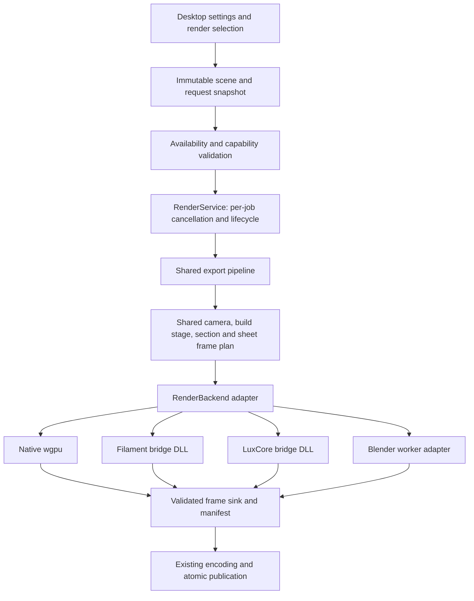

# Selectable desktop renderers

Date: October 15, 2026. Status: proposed architecture for review; no renderer implementation or SDK qualification has been performed by this planning task.

## Intent and scope

Let the desktop application select native wgpu, embedded Filament, embedded LuxCore, Blender Eevee, or Blender Cycles/OptiX for rendered previews and exports. Provide an attractive embedded alternative to Eevee and an embedded path tracer without requiring Blender. Preserve the current inspection, print geometry, output formats, durable jobs, and Blender choices. The user confirmed that the separate browser application is outside this work.

The implementation is complete only when all five output choices actually render supported requests in a packaged application. Merely listing unavailable backends is an intermediate milestone. Native wgpu and Filament are also selectable interactive viewport engines. LuxCore and the Blender engines render into the existing result pane; they do not replace the responsive inspection viewport.

All engine choices share physical scene intent. Pixel-identical results across engines are not a requirement. Geometry, framing, units, layer pitch, colors, and requested feature semantics must remain consistent. Differences in light transport and approximations must be visible to the user.

## Current integration points

These observations come from the working tree inspected for this plan:

| Location | Current responsibility / coupling |
| --- | --- |
| `src/render/worker.rs` | Persistent Blender process, ownership/cancellation, tool paths; `ToolPaths::validate()` requires Blender, FFmpeg, and ffprobe together. |
| `src/session.rs` | `RenderService` actor snapshots geometry/scene, locks jobs, starts Blender, then calls the export runner. |
| `src/export/jobs.rs` | Request validation, frame reuse, render dispatch, paired sections, sheets, encoding, publication; accepts only `eevee` and `cycles` and hashes Blender/Python resources. |
| `src/export/identity.rs` | Format-independent retained-job identity; engine and sampling already affect the key. |
| `src/presentation.rs` | Scene settings and accepted model; `model_scene()` emits scene JSON with physical, color-group, and layer metadata. |
| `src/viewport/gpu.rs`, `shaders/viewport.wgsl` | Interactive wgpu inspection, layer shading, clipping, edges, Ghost/Xray. Lighting is currently simple diffuse/specular shading. |
| `src/app.rs`, `src/app/controls.rs`, `sidebar.rs`, `help.rs` | Engine strings, preview routing, output-dependent controls, material changes, tool validation, saved-project handling, smoke scenarios. |
| `src/project.rs` | Project schema 1; animation and still engine strings are restricted to the two Blender choices. |
| `renderer/scene.py` | Blender-specific materials/studio, smooth bead flags, layer shading, build-up, section geometry and analysis, design edges. |
| `tools/package.ps1`, `tools/generate-notices.py` | Portable package and manifest; currently knows Cargo/Python resources and separately installed external tools. |

The working tree already contains unrelated README and browser changes. Preserve them. Planning changes are confined to the two new documents in this directory and the adjacent plans directory.

## Approaches considered

1. **One scene/job contract, engine adapters, common export pipeline — selected.** Extract the existing coupling once. Engine work can then proceed independently, and recovery/encoding remain consistent.
2. **Each engine implements its own complete export pipeline.** Easier initial demonstrations, but duplicates sections, timelines, caching, sheets, cancellation, and file publication; drift would appear as engine-specific output bugs.
3. **Replace Blender with one embedded renderer first.** Smaller immediate integration but defeats the requested comparison and risks losing existing outputs before replacements are qualified.

Use an internal, versioned adapter interface. Embedded SDKs are application-owned native libraries, not a public third-party plugin platform.

## User interaction

### Interactive viewport

Add **Viewport renderer** under View: **Native wgpu** and **Filament**. Default remains Native wgpu. The left pane always supports orbit/pan/zoom and shared CPU picking. Filament initially receives images through asynchronous offscreen readback, so its interactive frame rate must be measured rather than described as 60 fps.

Edges, Ghost/Xray, face selection, and uncapped inspection cuts continue through the existing wgpu inspection path. When one of those modes needs wgpu, show an explicit **Inspection uses Native wgpu** badge, retain the preferred viewport choice, and restore it on leaving that mode. This affects only the viewport; it never changes the output engine. Camera and model pose are unchanged across switches.

### Render preview and export

Extend the existing **Renderer** selector under Export:

| Label | Stable ID | Execution |
| --- | --- | --- |
| Native wgpu | `wgpu` | In process, raster PBR |
| Filament | `filament` | In process, raster PBR |
| LuxCore | `luxcore` | In process, path tracing |
| Blender Eevee | `blender_eevee` | Existing owned worker process |
| Blender Cycles / OptiX | `blender_cycles` | Existing owned worker process |

Preview follows the active output's engine, camera/layout, alpha policy, and feature requirements. Keep separate animation and still/sheet selections, as the application does today. Switching GIF to MP4 retains the animation selection; PNG and sheet share the still selection. Backend-specific quality values persist separately for animation and still usage, so changing engine does not reinterpret samples as another quality measure.

Keep current defaults for existing and new projects during rollout: Eevee animation, Cycles still/sheet, Native wgpu viewport. Do not auto-select a different engine when the user chooses Resin. Instead, explain raster approximations and suggest LuxCore/Cycles; the user makes the change. This deliberately replaces the current resin-triggered engine switch.

Unavailable engines remain visible with a short reason. A stored unavailable selection remains selected and blocks its preview/export with an actionable message. Do not silently render with another engine. Show renderer/device in render progress and completed-result details. Retain the previous result while a new preview runs, marked as belonging to its previous engine/settings.

Raster controls: anti-aliasing and shadow quality. Path-traced controls: samples per pixel and denoising. Blender Eevee retains its existing sample control. Avoid a generic samples value with a different meaning in every backend. Keep build settings, materials, and geometry controls independent of engine selection.

Tools/storage shows backend availability, supported features, SDK/build identity, selected device, and external encoder/tool status. Detailed DLL/ABI diagnostics belong there, not in the main rendering flow.

## Architecture and ownership

The UI submits immutable intent, not SDK handles. `RenderService` owns backend construction and destruction on its actor thread. A native context is created, used, and destroyed on its owning thread; it is never moved between arbitrary worker threads. SDK-internal render threads remain SDK-owned. The interactive Filament context has a separate owner from export rendering.

Use a per-task cancellation token, rather than resetting a single shared flag when the next job is submitted. Every preview result carries job ID, model/scene revision, selected engine, and viewport generation. Discard completions that no longer match the receiving pane. Invalidate accumulation and history when camera, material, geometry, dimensions, or engine changes.

Run one export at a time. Default to one active export backend context; release an idle context before allocating a different engine. While exporting, pause expensive progressive previews and retain the last result. A latest-only queue serves interactive Filament frames: one frame executing and one replacement request at most. Track readback completion before freeing textures or geometry. Do not accumulate an image queue when the UI is slow.

Cancellation is cooperative for embedded renderers. Poll between bounded sample batches/readback operations. Target acknowledgement within one second under a normally functioning driver; measure it. A blocked native driver call cannot safely be killed as a thread. Report that limitation in diagnostics; do not promise subprocess-style crash isolation or recover from an access violation. Preserve existing Blender Job Object cancellation behavior.

## Shared scene and geometry contract

Keep current accepted model/import semantics and `TNMESH01` snapshots. Introduce a typed, immutable `RenderSceneSnapshot` populated through one converter from `model_scene()`; store its validated legacy scene JSON for Blender compatibility. Its canonical coordinates are build-space millimeters, Z up. Each backend performs one documented conversion to its native units and camera axes. No backend independently normalizes a part to a unit cube.

The scene carries original positions, indexed triangles, normal/smoothing policy, face material ranges, layer ranges, first/later layer heights, print/build orientation, display transform, material parameters, lighting/studio recipe, and full-model reference bounds. Preserve build coordinates separately from displayed coordinates so grooves remain attached to the print after posing. Reuse the existing bead side/cap classification; do not smooth caps or duplicate grooves on bead/stepped geometry.

Introduce a shared Rust geometry realizer for embedded engines: visible deposited layers, original-solid build caps, arbitrary-axis sections and caps, material/range remapping, analysis, and design-edge geometry for sheets. Reuse `BuildUpSolid` for original STL build caps. Port the required general section logic from `renderer/scene.py`; clip independently closed bead/layer components without filling intentional gaps. Open/nonmanifold input cannot acquire an invented solid cap or volume. Full-model reference bounds continue to govern floor and camera framing during build-up and cuts.

Migrate in two stages. First wrap Blender's existing geometry path intact. Then feed equivalent realized geometry to Blender through an explicit prepared-geometry protocol mode, disabling only its duplicate clipping/build-up/edge operations. Compare against the legacy path before making prepared geometry the default. Legacy retained jobs retain their legacy geometry semantics. Static turntables retain batched Blender animation and mesh upload reuse; a new per-frame abstraction must not force Blender into the slower still-render loop.

`FramePlan` defines camera, model rotation, visible layer count, panel, dimensions, and physical time for each output frame. Derive it using existing timeline/turntable rules. Reuse identical poses only when camera, geometry visibility, material, projection, and all other pixel inputs match. Keep exact-repeat reuse for multi-turn animations and retain whole-layer build-up semantics.

The current timeline animates only camera orbit/pan/spiral/easing, optional turntable rotation, and optional deposited build-up. Materials, print/display orientation, studio, section specification, quality, and color mapping remain fixed in the immutable job snapshot. Resolve those supported animated values into each `FrameSpec`; adapters do not interpret timeline objects. Paired section panels carry their resolved static section option per frame. Future material/light/section animation requires a versioned contract extension rather than adapter-local interpretation.

Materials are renderer-independent intent: linear RGB, roughness, preset, metal/clearcoat intent where applicable, transmission, index of refraction, and absorption/scattering coefficients per millimeter. A shared resolver translates current clarity/cloudiness controls to those parameters, using current Blender formulas as the baseline. Adapters map that intent to their SDK. Raster resin is approximate; path-traced resin supports volume transport. Preserve warnings about internal interfaces in overlapping beads and stacked solids. Layer shading must be visibly qualified in every engine, including closeups and subpixel fade.

## Pixels, alpha, temporal state, and output

The common CPU image boundary is tightly packed RGBA8, top row first, display-encoded sRGB with straight alpha. Backends identify their exposure/tone-mapping recipe. Normalize row alignment, channel order, vertical origin, and premultiplied alpha in each adapter. Apply display encoding once. A shared image validator checks exact dimensions and byte count before PNG encoding/publication.

Use the existing Blender AgX configuration unchanged while adding engines. Filament may use its native AgX mapping; wgpu and LuxCore use a versioned shared AgX approximation/LUT qualified with a color/exposure chart. Record differences rather than asserting identical AgX implementations. Tone mapper, LUT, exposure, and shader/material recipe hashes affect frame identity. Preserve linear color controls and avoid double gamma conversion.

Transparent background is distinct from material transmission. PNG may have transparent surroundings; GIF/MP4 remain opaque under current policy. Four-view panels use alpha for composition into the existing opaque sheet. Qualify transparent resin over both black and white backgrounds to catch incorrect premultiplication and edge fringes.

Export rendering resets temporal history per distinct pose. Raster exports use a fixed, versioned jitter/sample sequence; path-traced exports use a fixed seed derived from canonical frame inputs, not wall-clock time. Never carry progressive accumulation across animation poses. Denoising is part of the render recipe; test temporal shimmer and layer-detail loss. Do not depend on temporal denoising across frames in the first implementation.

Keep existing limits: at most 2,000,000 source vertices, 4,000,000 triangles, 1 MiB scene metadata, 8 MiB serialized timeline states, 10,000 animation frames, and 8,000 requested output pixels per side. Existing stricter format/panel limits still apply. Derived geometry and GPU expansion use checked allocation budgets; fail explicitly when expansion exceeds capacity. Tile high-resolution renders when necessary, using a common full-image projection and seam/alpha tests. Budget CPU readback, normals/material attributes, BVH, denoiser and staging memory in addition to mesh bytes. Never reduce requested quality or resolution silently.

## Backend contract and discovery

The contract separates five concerns: stable selection/settings, capability assessment, runtime identity, scene upload, and frame/sequence production. Adapters emit typed progress and pixels/validated frame artifacts; only the common pipeline owns durable manifests and final output publication. Blender may stream its already-written PNGs as frame artifacts to retain the optimized animation producer. The host validates them identically before accepting them.

Capabilities distinguish `Supported`, `Approximate` with an explanation, and `Unsupported` with a reason. Assess a complete request, not just whether an engine DLL exists. Examples: missing OptiX device, unsupported requested material volume, section cap unsupported during rollout, alpha support, output dimensions beyond limits, and missing encoder. Approximation for the user-selected raster renderer is allowed only with the visible explanation recorded in the recipe; an unsupported feature blocks execution.

Split dependency validation by operation:

| Operation | Requirements |
| --- | --- |
| Embedded PNG / sheet / preview | Selected embedded backend and device; no Blender, FFmpeg, or ffprobe |
| Embedded GIF | Selected embedded backend plus current GIF encoder's FFmpeg requirement |
| Embedded MP4 | Selected embedded backend plus FFmpeg and ffprobe, including codec capability |
| Blender PNG / sheet / preview | Blender and selected engine/device; no encoder tools |
| Blender GIF / MP4 | Blender plus the corresponding encoder requirements above |
| Re-encode verified retained frames | Encoder requirements only; original renderer need not be installed |

Discovery loads only explicitly packaged libraries from a canonical application-owned directory. Load/query native SDKs lazily; no probing all heavy GPU contexts on startup. Build-time manifest presence is not proof that the runtime device works. Cache probe results by library/device identity and offer explicit retry. Device choice is part of the saved backend configuration; failure to obtain that device is actionable, not an implicit CPU/device fallback.

## Embedded SDK boundary and qualification

Implement one small versioned C ABI shared by two application-owned bridge DLLs: `turninator_filament.dll` and `turninator_luxcore.dll`. Rust owns input/output buffers; the DLL copies or retains inputs only under the documented handle lifetime, never frees Rust memory, and never lets a C++ exception cross the ABI. Keep engine contexts opaque; use explicit create/destroy, upload, begin frame, poll, read pixels, and cancel operations. Return bounded structured diagnostics and numeric status codes. Check ABI version and struct sizes before creating a context. Keep library handles alive through all pending callbacks and context destruction.

Freeze the ABI state machine before delegating SDK work. A context transitions `Idle -> Rendering -> Ready -> Idle`; an upload is permitted only in Idle and copies geometry/material payloads before returning. `begin_frame` copies frame camera/transform/quality/image parameters and references an already-uploaded geometry revision; it is rejected while another frame/readback is active. Geometry changes require a new revision upload; transform-only changes reuse the uploaded geometry. `poll` is nonblocking and reports progress, readiness or error without calling Rust. `read_rgba8` is permitted in Ready, writes one complete image into checked caller capacity and consumes readiness only after success. An undersized buffer leaves Ready intact. Cancellation is a nonblocking request; poll acknowledges `Cancelled` only after pending SDK work and readback have drained, then returns Idle. Subsequent jobs may not reuse the context before that acknowledgement. Fatal SDK errors put the context in Failed; only diagnostics and destruction are then allowed. Destroy drains normal pending work and frees all callbacks/resources on the owner thread. A hung driver still cannot be forcibly interrupted in process.

Host progress includes current frame/panel, completed/total work, stage and optional partial image. Rate-limit partial images to five per second with latest-only replacement. They never satisfy a completed-frame manifest entry, and their job/revision/engine tags are checked before display. Drop progress after cancellation or generation replacement. Native poll progress is translated by the Rust owner into this common channel.

Do not link optional SDK DLLs into the executable's mandatory import table. A missing/incompatible optional library must disable that choice while the app and existing renderers continue working. Source builds without embedded SDKs remain supported; the full release package must contain qualified versions of both embedded backends and their redistributable dependencies/assets.

Qualification precedes backend implementation. For each SDK, record an immutable release/commit, archive SHA-256, compiler/CRT requirements, backend/device support, transitive redistributables, license/notice obligations, shader/asset tool versions, and measured initialization/readback/teardown. No floating release or runtime download. Filament material compilation and environment preprocessing happen during controlled builds, or through embedded libraries if dynamic compilation is needed; runtime rendering never shells out to `matc`/`cmgen` or a renderer executable. LuxCore runtime kernel compilation/cache is permitted inside the application and must be measured separately from warm rendering.

Initial Windows target is `x86_64-pc-windows-msvc`. Native wgpu stays portable; optional SDK support on other targets is explicitly unqualified until separately built and tested. Qualify Filament offscreen rendering and LuxCore CUDA/OptiX on the local RTX 4070 Ti. An SDK that fails qualification remains visibly unavailable and is reported as unfinished integration; continue independent core work rather than silently substituting a different engine.

## Persistence, identity, and recovery

Project schema 2 stores typed output selections/quality profiles and viewport preference. Read schema 1 by mapping `eevee` to `blender_eevee`, `cycles` to `blender_cycles`, preserving samples, camera, materials, timings, and output settings. New schema-2 files need not load in the old application. Reject unknown renderer IDs and future project schemas clearly; keep recognized but unavailable selections intact. Preserve application settings schema-1 files with defaulted new preferences.

In schema 2, `ProjectFile.renderers: RendererPreferences` owns the renderer selections/profiles; remove the old top-level `engine`, `output_options.still_engine`, `samples`, and `still_samples` from the new serialized form. Keep all non-renderer output preferences. Application settings store only default renderer preferences for projects created afterward; opening a project does not rewrite those defaults. Viewport changes are saved in the project when a project is saved. New retained requests store `schema_version: 2` and `selection`; their legacy reader accepts unversioned `engine`/`samples` without writing them back until a new request is created.

Retained request JSON uses a new explicit schema version. Read legacy `engine`/`samples` requests through a compatibility converter. Never reinterpret old `eevee` frames as wgpu or another engine. New pixel identity includes scene/geometry/frame plan, backend ID, full effective quality, native SDK and bridge hashes, shaders/material assets, color recipe, denoiser, geometry-realizer version, and selected device/API/driver identity. Encoder/codec/output path remain separate where pixels are compatible.

Old request/recipe/manifest readers remain versioned. Old frames can be validated and re-encoded without a renderer. Missing frames require the original compatible renderer/recipe or an explicit fresh render; do not relabel new pixels with old provenance. Use immutable job snapshots and atomic manifests/output publication. Preserve cache locks, owned-directory checks, protected source paths, retained failure state, and bounded reservation checks.

Old projects preserve saved intent; existing retained frames preserve their original pixels. A new render from an old project uses the current qualified renderer/geometry recipe and may have documented appearance changes. Legacy retained jobs continue their original geometry mode and cannot be filled with pixels from the prepared-geometry recipe. Regenerating them under a new recipe creates a new artifact set rather than modifying the old set's provenance.

Preserve two levels of identity: the outer retained-job key groups equivalent requested scene/selection intent independently of SDK availability; the inner pixel-recipe key contains the concrete resolved runtime/device identity and effective settings. Resolve and validate the backend on the actor before looking up reusable pixels or allocating its frame artifacts. Encoding-only recovery validates the original manifest without loading the renderer. Never initialize native GPU contexts on the UI thread merely to compute a retained-job key.

## Delivery and delegation

Implement the shared contract and Blender adapter first, with an unchanged-output regression gate. Qualify SDKs next. After the contract is committed and tested, three workers may work independently on wgpu, Filament, and LuxCore adapters. A coordinator owns scene realization, pipeline, selection UI, persistence, packaging, and integration.

Only three workers run concurrently, leaving the fourth slot for coordination. Assign distinct files and isolated worktrees. SDK workers may not edit shared contract or Cargo lockfiles concurrently; propose contract changes to the coordinator before coding against them. Review each adapter against the same conformance fixtures. Integrate and benchmark GPU work serially to avoid contaminated measurements.

This planning task does not start implementation workers. The implementation plan supplies exact boundaries and acceptance gates for a later execution run.

## Acceptance and evidence

1. All five output engines render a preview, PNG, GIF, MP4, and four-view sheet for supported opaque scenes; wgpu/Filament can also be selected for ordinary interactive viewing.
2. Closed-solid sections, paired cutaways, static stages, whole-layer build-up, camera timelines, tool/feature colors, bead/stepped geometry, and layer shading work through each output backend. Unsupported interim combinations are visibly blocked, never quietly omitted.
3. LuxCore/Cycles show qualified resin transmission and absorption/scattering; raster alternatives explain their approximation. Geometry interfaces remain disclosed.
4. Missing Blender/encoder tools do not block an embedded PNG or inspection. Missing bridge DLL/dependency/ABI/device produces a useful reason and leaves other choices usable.
5. Switching engines, changing models, cancellation, retry, reopening projects, and re-encoding retained frames do not display stale results or reuse incompatible pixels.
6. A packaged build launched from another working directory passes with Blender/FFmpeg/ffprobe absent for embedded PNGs. A full package includes both qualified embedded engines; a core-only development build identifies them as unavailable.
7. Record matched cold/warm timings at 960 square/80 frames/20 fps and 4096-square stills, plus preview responsiveness, upload/readback/encoding time, cancellation latency, peak host/VRAM usage, and idle memory after repeated switching. Hold scene, pose, dimensions and GPU load constant; report each backend's actual quality settings rather than implying equal samples imply equal quality.

Use synthetic dimension/color/alpha/cap fixtures plus representative real STL and G-code scenes. Compare geometry masks, physical extents, camera alignment, layer pitch and warnings across engines. Use numeric tolerances for those invariants and human-reviewed images for appearance; do not demand exact cross-engine RGB equality. Preserve exact or tightly qualified same-engine Blender regression comparisons where deterministic. The final native UI must be exercised visibly; compilation alone does not qualify the integration.

Freeze shared invariant tolerances before backend delegation: analytic geometry dimensions/cap area use relative error at most 0.00001 with an absolute floor of 0.0001 mm for lengths and 0.0001 square mm for areas on the small synthetic fixtures; larger-coordinate fixtures also account for the explicitly calculated f32 coordinate ULP (unit in the last place), with no tolerance-based topology repair. Camera diagnostic masks on the 512-square cube/hollow fixture permit edge differences only within one pixel of the expected boundary, with intersection-over-union at least 0.995. Loss of an interior hole or disconnected strand is always failure. CPU channel/row/alpha conversions permit at most one 8-bit code value error; exact byte counts, index/range coverage, frame counts and whole-layer counts have no tolerance. Layer pitch must remain physically unchanged, with closeup crest spacing within one pixel at a fixed camera. Freeze those fixtures and expectations in Task 4. Backend-specific lighting/resin appearance and stochastic noise baselines are separately reviewed during SDK/backend qualification, never used to weaken these invariant checks.

## Source references and limits

- [Filament upstream](https://github.com/google/filament): native C++ API, rendering features, backends, and matching material-tool/runtime versions.
- [Filament Renderer API](https://github.com/google/filament/blob/main/filament/include/filament/Renderer.h): asynchronous pixel readback and rendering lifetime details to verify against the chosen version.
- [LuxCore library/API](https://github.com/LuxCoreRender/LuxCore#luxcore-library), [public header](https://github.com/LuxCoreRender/LuxCore/blob/main/include/luxcore/luxcore.h): embedded scene/session/film interfaces.
- [LuxCore RTX support](https://luxcorerender.org/new-features-in-v2-5/) and [materials/volumes](https://luxcorerender.org/advanced-features/): available rendering capabilities, not a qualification of our package.
- [wgpu 30.0.1 ray queries](https://docs.rs/wgpu/30.0.1/wgpu/struct.Features.html#associatedconstant.EXPERIMENTAL_RAY_QUERY): experimental native functionality. A custom hardware path tracer is outside this plan; Native wgpu remains the raster backend.
- Existing repository evidence: `docs/performance.md`, `docs/runtime-support.md`, `docs/ui-design.md`, and the source paths above. Historical timings guide fixture choice only; no new backend speed claims are made here.

Filament and LuxCore have not been built, linked, rendered, or benchmarked for Turninator during planning. Their upstream features are evidence of feasibility, not proof of our integration.
